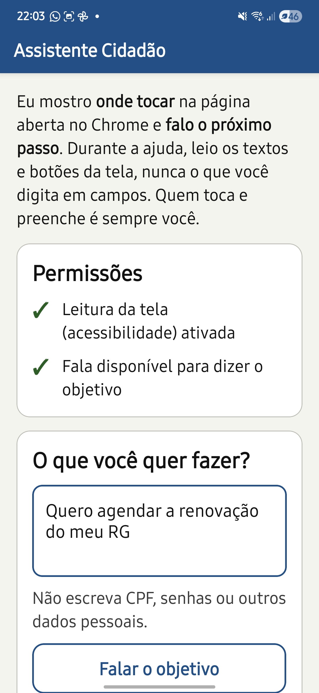
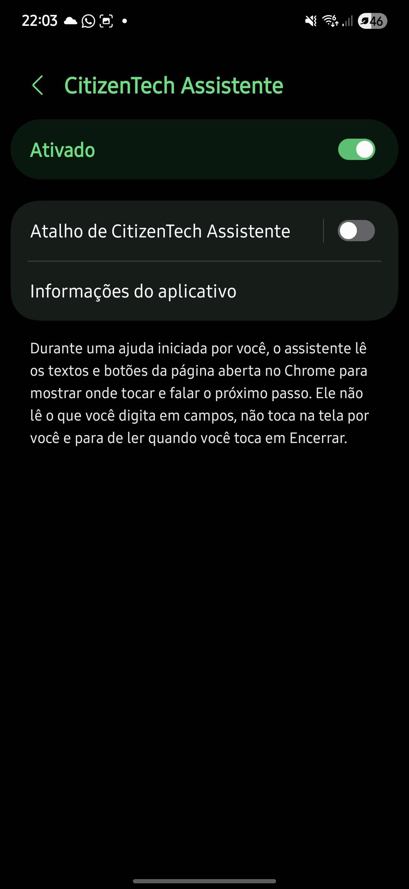
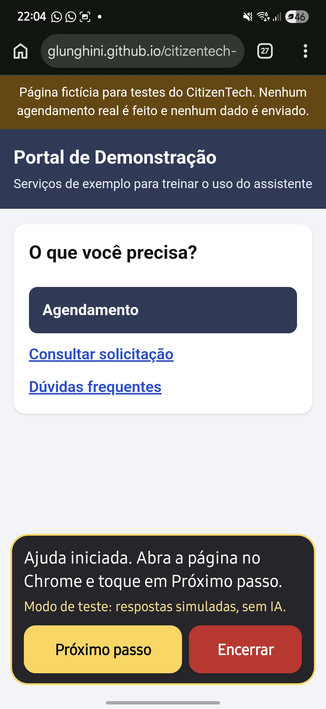
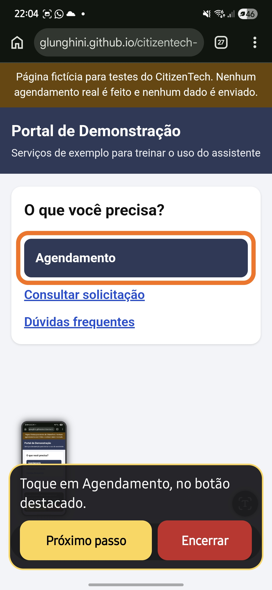
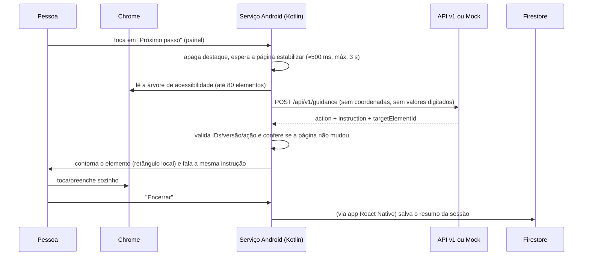

# CitizenTech Assistente — app Android (Mobile Development & IOT)

Assistente que ajuda pessoas idosas e pessoas com dificuldade em tecnologia a usar uma página no **Chrome**.
A pessoa diz o que quer fazer. O assistente lê os elementos da página, **contorna o botão certo** e **fala a instrução**.
Quem toca e preenche é sempre a própria pessoa: o app nunca clica por ela.

**Vídeo do app rodando (1 min 8 s):** <https://youtube.com/shorts/Zq5ZBuCQdcU>

---

## 1. Ficha da CitizenTech

| Item | Conteúdo |
| --- | --- |
| Nome da CitizenTech | CitizenTech Assistente |
| Cidade e bairro | São Paulo (SP), Bela Vista |
| Cidadão beneficiado | Pessoas idosas e pessoas com dificuldade em usar serviços digitais no celular |
| Problema, em uma frase | Muita gente não consegue concluir sozinha um serviço em um site porque não sabe onde tocar nem qual é o próximo passo. |
| Como funciona | O app desenha um painel por cima do Chrome. A cada “Próximo passo”, lê a página, pede a orientação (modo de teste ou API), contorna o elemento certo e fala a instrução em português. |
| O que cada parte faz | **App (este repositório):** telas, permissões, leitura da tela, destaque, voz e histórico no Firebase. **API (opcional, modo real):** recebe a leitura da página e devolve a orientação no contrato v1. |
| Link do repositório | <https://github.com/glunghini/citizentech-mobile> |
| Página de demonstração | <https://glunghini.github.io/citizentech-mobile/demo/> (fictícia) |
| Link da API | Não usada nesta entrega: o app roda em **modo de teste** (respostas simuladas). |
| Indicador de impacto | % de ajudas que chegam à etapa “concluída” e nº médio de passos por ajuda, calculados a partir do histórico salvo. Ainda sem medição com usuários reais: nesta entrega houve apenas o teste do próprio grupo na página de demonstração. |
| ODS conectados | **ODS 10** (Redução das desigualdades): reduz a exclusão digital de quem tem menos familiaridade com tecnologia. **ODS 11** (Cidades e comunidades sustentáveis): facilita o acesso a serviços da cidade. |

## 2. Integrantes

| Nome | RM | Responsabilidade |
| --- | --- | --- |
| David Alexandre Cordeiro Paixão | 557538 | Desenvolvimento do app mobile |
| Guilherme Lunghini Teixeira | 556892 | Desenvolvimento do app mobile |
| Marchel Augusto Ribeiro de Matos | 99856 | Desenvolvimento do app mobile |
| Tiago Morais Neto | 555619 | Desenvolvimento do app mobile |
| Vinicius Augusto Siqueira Gonçalves | 557065 | Desenvolvimento do app mobile |

## 3. Telas e navegação (Expo Router)

| Rota | Tela | O que faz |
| --- | --- | --- |
| `/` | Início | Explica o app, mostra o estado das permissões, recebe o objetivo (escrito ou falado), inicia e encerra a ajuda e mostra o modo (teste ou real). |
| `/permissoes` | Permissões | Passo a passo para ligar o serviço de acessibilidade, botão que abre as configurações e explicação do que é lido. |
| `/historico` | Histórico | Lista as ajudas salvas no Firestore, com data, nº de orientações, situação e modo. |
| `/historico/[id]` | Detalhes | Objetivo, início/fim, motivo do encerramento e cada passo (ação, instrução, requestId, falhas). |
| `/sobre` | Como funciona | Para quem é, como usar, privacidade e limites. |
| *(sobre o Chrome)* | Painel flutuante | Mensagem + **Próximo passo** + **Encerrar** (+ **Responder** quando o assistente faz uma pergunta). |
| *(sobre o Chrome)* | Caixa de resposta | Activity curta para responder por texto ou fala quando a ação é `ask`. |

### Prints (celular Android real, dados fictícios)

| Tela inicial | Serviço de acessibilidade ativado |
| --- | --- |
|  |  |

| Painel sobre o Chrome | Destaque no botão certo |
| --- | --- |
|  |  |

## 4. Tecnologias e versões

| Item | Versão |
| --- | --- |
| Expo SDK | 58 (`expo ~58.0.25`) |
| React Native / React | 0.88.1 / 19.3.0 |
| Navegação | Expo Router `~58.0.32` |
| Banco de dados | Firebase JS SDK `^12.19.0`: Cloud Firestore + Authentication anônima |
| Código nativo | Módulo Expo local em Kotlin (`modules/citizen-assist`) |
| Voz | `TextToSpeech` do Android (pt-BR) e reconhecimento de fala do sistema |
| Build | EAS Build (plano gratuito), perfil `preview`, APK de release |
| Aparelho usado nos testes | Celular Samsung com Android e Google Chrome |

## 5. Custo: 100% gratuito

| Parte | Como fica de graça |
| --- | --- |
| Build do app | EAS Build no plano Free (fila de baixa prioridade). Também dá para compilar no próprio computador com Android Studio. |
| Banco | Firebase no plano **Spark** (gratuito). Não usa Cloud Functions, que exigem o plano pago. |
| Página de demonstração | GitHub Pages (gratuito), pasta `docs/`. |
| Orientações | Modo **mock** roda no celular, sem servidor. |
| Voz | Recursos do próprio Android. |

## 6. Como rodar

> **Expo Go não funciona** com este projeto: ele não carrega o código nativo (serviço de acessibilidade e overlay).

### 6.1 Firebase (uma vez)

1. Em <https://console.firebase.google.com>, crie um projeto (plano Spark).
2. **Authentication** → Método de login → ative **Anônimo**.
3. **Firestore Database** → Criar banco (modo produção) → aba **Regras** → cole o conteúdo de [`firestore.rules`](firestore.rules) → Publicar.
4. **Configurações do projeto** → Seus apps → adicione um **App da Web** e copie os valores de `firebaseConfig` para o `.env`.

### 6.2 Configuração local

Requer Node.js **22.13 ou mais novo**.

```bash
npm install
cp .env.example .env     # no Windows: copy .env.example .env
```

| Variável | Uso |
| --- | --- |
| `EXPO_PUBLIC_GUIDANCE_MODE` | `mock` (respostas simuladas) ou `real` (API HTTP) |
| `EXPO_PUBLIC_API_BASE_URL` | Raiz do servidor **sem** `/api/v1`, só no modo real. Nunca `localhost`: no emulador use `10.0.2.2`; no celular, o IP do computador na mesma rede. |
| `EXPO_PUBLIC_DEMO_URL` | Endereço da página de demonstração |
| `EXPO_PUBLIC_FIREBASE_*` | Configuração do app Web do Firebase |

Tudo que começa com `EXPO_PUBLIC_` vai dentro do APK. **Nunca** coloque chave de IA, senha de banco ou segredo de servidor no `.env` do app.

### 6.3 Gerar o APK na nuvem (caminho usado nesta entrega)

```bash
npx eas-cli@latest login
npx eas-cli@latest build -p android --profile preview
```

- O perfil `preview` está em [`eas.json`](eas.json) e gera um **APK de release** com o JavaScript embutido (não depende do Metro).
- O arquivo [`.easignore`](.easignore) define o que **não** sobe para o build. Ele existe porque o `.gitignore` ignora o `.env`; sem o `.easignore`, o APK sairia sem a configuração do Firebase. As regras `/android/` e `/ios/` têm barra no começo para ignorar só as pastas geradas na raiz, e **não** `modules/citizen-assist/android`, onde está o código Kotlin.
- No fim, o EAS mostra um link/QR code para baixar o APK no celular.

**Instalar no celular (Android 13+):**

1. Se o **Google Play Protect** bloquear a instalação (ele bloqueia apps fora da loja que usam acessibilidade): Play Store → foto do perfil → Play Protect → engrenagem → desligue a verificação, instale e **ligue de novo**.
2. Ao tentar ativar a acessibilidade, o Android mostra “Acesso negado / configuração restrita”. Abra **Configurações → Aplicativos → CitizenTech Assistente → ⋮ → Permitir configurações restritas** e ative de novo em **Acessibilidade → Aplicativos instalados → CitizenTech Assistente**.

### 6.4 Alternativa: development build local (não usada nesta entrega)

Com Android Studio (SDK + emulador com imagem Google Play) e JDK configurados: `npx expo run:android`. Depois de mudar algo em `modules/citizen-assist`, rode o comando de novo. A pasta `android/` é gerada e fica fora do Git; todo o código nativo próprio está em `modules/`.

### 6.5 Página de demonstração

A página fictícia fica em [`docs/demo/index.html`](docs/demo/index.html) e está publicada pelo GitHub Pages (*Settings → Pages → `main` / `/docs`*). Ela simula: Agendamento → Renovação de RG → Município → horário → confirmação.

### 6.6 Usando

1. No app, escreva ou fale o objetivo (ex.: “Quero agendar a renovação do meu RG”) e toque em **Iniciar ajuda**.
2. Abra a página no **Chrome**. O painel aparece por cima.
3. Toque em **Próximo passo**: o assistente lê a página, contorna o elemento e fala.
4. Toque você mesmo no elemento e peça o próximo passo.
5. **Encerrar** (no painel ou no app) para a voz, apaga o destaque e envia o resumo para o Firestore.

## 7. Fluxo e contrato v1



- **Endpoint:** `POST {baseUrl}/api/v1/guidance` com `contractVersion "1"`, `requestId`/`sessionId`/`snapshotId` (UUID), `locale "pt-BR"`, `goal`, `userMessage`, `history` (últimas 3 orientações) e `screen.elements[]` (`id`, `role`, `text`, `enabled`).
- **Ações aceitas:** `highlight` (com alvo habilitado do snapshot atual), `explain`, `ask` e `complete` (todas sem alvo). Qualquer outra resposta é recusada **sem destaque e sem fala**.
- **Erros tratados:** 400, 409, 413, 429, 502, 503, 504, 500, respostas sem JSON, falta de internet, DNS/TLS e timeout de 25 s. Nunca há nova tentativa automática: a pessoa toca de novo.
- **Mock:** usa o mesmo caminho da chamada HTTP (mesma requisição e mesma validação), espera ~500 ms e responde no formato v1. Conhece as telas da página de demonstração. **Não é IA**, e o painel avisa “Modo de teste: respostas simuladas, sem IA”.
- Uma só chamada por toque; o botão fica bloqueado enquanto espera; **Encerrar** cancela a chamada e ignora respostas atrasadas.

## 8. Banco de dados (Cloud Firestore)

Cada ajuda encerrada vira um documento em `sessions/{sessionId}`:

| Campo | Conteúdo |
| --- | --- |
| `sessionId` | UUID da ajuda |
| `uid` | Usuário anônimo do Firebase (cada aparelho só vê o próprio histórico) |
| `goal` | Objetivo digitado/falado (orientamos a não usar dados pessoais) |
| `mode` | `mock` ou `real` |
| `startedAt` / `endedAt` | Data/hora (ms) |
| `endReason` | `user`, `app`, `screen_off`, `service_stopped` ou `restarted` |
| `completed` | `true` se o assistente indicou `complete`. **Não** significa serviço real concluído. |
| `steps[]` | `requestId`, `at`, `action`, `instruction`, `result` (`success`/`failure`/`discarded`), `errorCode` |
| `savedAt` | Data do servidor |

**Não** são salvos: textos da página, elementos, coordenadas, valores digitados, senhas ou capturas de tela. Se a gravação falhar, o resumo fica pendente e é reenviado quando o app volta ao primeiro plano. As regras de acesso estão em [`firestore.rules`](firestore.rules).

**Situação:** a gravação está implementada, mas **não foi comprovada** nos testes desta entrega. Na conferência de 17/11/2026, a coleção `sessions` do Firestore estava vazia (ver seção 10).

## 9. Acessibilidade do próprio app

- Fontes de 20 a 26 sp, que acompanham o tamanho de fonte do sistema, e botões com 56 a 60 dp de altura.
- Alto contraste: texto escuro em fundo claro e botões azul-escuro ou vermelho-escuro com texto branco. O destaque é laranja com borda branca.
- `accessibilityRole`, `accessibilityLabel`, `accessibilityHint` e estado *desativado* em todos os botões, além de títulos marcados como cabeçalho.
- O objetivo pode ser **falado** ou digitado, e as orientações são **faladas** e escritas.
- Linguagem simples e uma instrução por vez. O painel muda para o alto da tela quando o elemento destacado está embaixo.

## 10. O que foi e o que não foi testado

| Item | Situação |
| --- | --- |
| APK de release gerado pelo EAS Build, instalado em celular Samsung (sem Metro) | ✅ |
| Serviço de acessibilidade ativado pelo usuário | ✅ print 02 |
| Objetivo falado pelo reconhecimento de voz do Google | ✅ vídeo |
| Painel “Próximo passo / Encerrar” sobre o Chrome, sem bloquear os toques na página | ✅ prints 03–04 e vídeo |
| Jornada completa na página de demonstração: Agendamento → Renovação de RG → Município → horário → Confirmar → mensagem de conclusão | ✅ vídeo |
| Destaque some e o painel avisa “A página mudou” quando a página muda | ✅ vídeo |
| Modo de teste identificado no painel | ✅ print 03 |
| Voz lendo as instruções (TextToSpeech) | ✅ vídeo: há fala logo após cada “Próximo passo” |
| Validação do contrato v1 e regras do mock | ✅ 38 verificações automatizadas em JVM (`tests/jvm/`) |
| Gravação no Firestore e tela Histórico | ❌ não comprovado (coleção vazia na conferência) |
| Modo real com API | ❌ não testado |
| Emulador / `npx expo run:android` | ❌ não testado (o caminho usado foi o EAS Build) |

## 11. Limitações conhecidas

- Android + Chrome apenas, testado em um único celular. Não há garantia para outros sites ou navegadores.
- A gravação no Firestore não foi comprovada nesta entrega (seção 8).
- Logo depois de uma mudança de página, o contorno antigo pode aparecer por um instante na posição anterior até ser removido.
- O painel ocupa a parte de baixo (ou de cima) da tela e pode cobrir parte da página.
- Sites com animação contínua podem nunca “estabilizar”: o assistente pede para tentar de novo em vez de apontar.
- O mock só conhece a página de demonstração. Em outros sites ele responde “Esta é uma resposta de teste…”.
- Instalar fora da Play Store exige liberar o Play Protect e as configurações restritas (seção 6.3).
- Sem captura de tela/OCR: se a árvore de acessibilidade não servir para um site, o assistente não consegue orientar.

## 12. Privacidade e segurança

- O serviço acompanha só o pacote `com.android.chrome` e só lê enquanto a ajuda está ativa.
- Para campos, envia apenas o rótulo (nunca o texto digitado nem a opção escolhida). Senhas nunca são lidas.
- Nenhum conteúdo de tela vai para logs ou para o banco.
- Sem toque automático, sem gestos e sem touch exploration.
- Bloquear a tela encerra a ajuda e limpa tudo.
- Nenhuma chave de IA no app.

## 13. Estrutura

```
app/                      telas (Expo Router)
src/                      contexto do assistente, Firebase, Firestore, componentes de UI
modules/citizen-assist/   módulo Expo local (Kotlin): serviço, leitura, overlay, voz, HTTP e mock
docs/demo/                página fictícia de demonstração (GitHub Pages)
docs/prints/              prints deste README
tests/jvm/                testes do contrato v1 e do mock (JVM)
eas.json, .easignore      configuração do build na nuvem
firestore.rules           regras do banco
prompts.md                registro do uso de IA (exigido pela GS)
```
