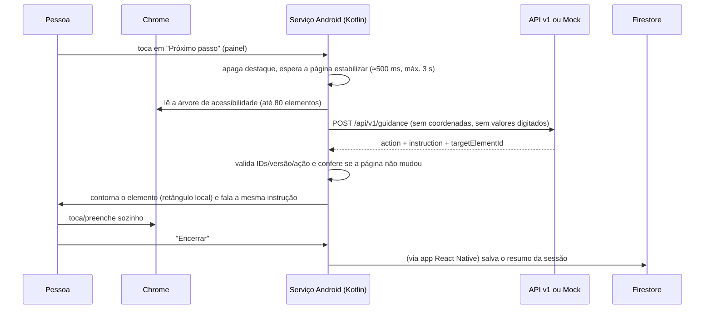

# CitizenTech Assistente — app Android (Mobile Development & IOT)

Assistente que ajuda pessoas idosas e pessoas com dificuldade em tecnologia a usar uma página no **Chrome**.
A pessoa diz o que quer fazer. O assistente lê os elementos da página, **contorna o botão certo** e **fala a instrução**.
Quem toca e preenche é sempre a própria pessoa: o app nunca clica por ela.

> Os campos marcados como **PENDENTE** ainda precisam ser preenchidos pelo grupo, apenas com informações confirmadas.

---

## 1. Ficha da CitizenTech

| Item | Conteúdo |
| --- | --- |
| Nome da CitizenTech | CitizenTech Assistente *(PENDENTE: confirmar o nome do grupo)* |
| Cidade e bairro | **PENDENTE** |
| Cidadão beneficiado | Pessoas idosas e pessoas com dificuldade em usar serviços digitais no celular |
| Problema, em uma frase | Muita gente não consegue concluir sozinha um serviço em um site porque não sabe onde tocar nem qual é o próximo passo. |
| Como funciona | O app desenha um painel por cima do Chrome. A cada “Próximo passo”, lê a página, pede a orientação (API ou modo de teste), contorna o elemento certo e fala a instrução em português. |
| O que cada parte faz | **App (este repositório):** telas, permissões, leitura da tela, destaque, voz e histórico no Firebase. **API (opcional, modo real):** recebe a leitura da página e devolve a orientação no contrato v1. |
| Link do repositório | **PENDENTE** |
| Link da API | **PENDENTE** (só para o modo real) |
| Indicador de impacto | *Sugestão, confirmar com o grupo:* % de ajudas que chegam à etapa “concluída” e nº médio de passos por ajuda, calculados a partir do histórico salvo. **Resultados: PENDENTES** (validação com usuários ainda não feita). |
| ODS conectados | *Confirmar com o grupo:* **ODS 10** (Redução das desigualdades): reduz a exclusão digital de quem tem menos familiaridade com tecnologia. **ODS 11** (Cidades e comunidades sustentáveis): facilita o acesso a serviços da cidade. |

## 2. Integrantes

| Nome | RM | Responsabilidade |
| --- | --- | --- |
| PENDENTE | PENDENTE | PENDENTE |

## 3. Telas e navegação (Expo Router)

| Rota | Tela | O que faz |
| --- | --- | --- |
| `/` | Início | Explica o app, mostra o estado das permissões, recebe o objetivo (escrito ou falado), inicia e encerra a ajuda e mostra o modo (teste ou real). |
| `/permissoes` | Permissões | Passo a passo para ligar o serviço de acessibilidade, botão que abre as configurações e explicação do que é lido. |
| `/historico` | Histórico | Lista as ajudas salvas no Firestore, com data, nº de orientações, situação e modo. |
| `/historico/[id]` | Detalhes | Objetivo, início/fim, motivo do encerramento e cada passo (ação, instrução, requestId, falhas). |
| `/sobre` | Como funciona | Para quem é, como usar, privacidade e limites. |
| *(sobre o Chrome)* | Painel flutuante | Mensagem + **Próximo passo** + **Encerrar** (+ **Responder** quando o assistente faz uma pergunta). |
| *(sobre o Chrome)* | Caixa de resposta | Activity curta para responder por texto ou fala quando a ação é `ask`. |

**Prints:** coloque as imagens em `docs/prints/` (apenas dados fictícios) e troque as linhas abaixo.

- `docs/prints/01-inicio.png`: **PENDENTE**
- `docs/prints/02-permissoes.png`: **PENDENTE**
- `docs/prints/03-painel-sobre-chrome.png`: **PENDENTE**
- `docs/prints/04-destaque.png`: **PENDENTE**
- `docs/prints/05-historico.png`: **PENDENTE**
- `docs/prints/06-detalhe.png`: **PENDENTE**
- `docs/prints/07-firestore-console.png`: **PENDENTE** (evidência do banco)

## 4. Tecnologias e versões

| Item | Versão |
| --- | --- |
| Expo SDK | 58 (`expo ~58.0.25`) |
| React Native / React | 0.88.1 / 19.3.0 |
| Navegação | Expo Router `~58.0.32` |
| Banco de dados | Firebase JS SDK `^12.19.0`: Cloud Firestore + Authentication anônima |
| Código nativo | Módulo Expo local em Kotlin (`modules/citizen-assist`) |
| Voz | `TextToSpeech` do Android (pt-BR) e reconhecimento de fala do sistema |
| Aparelho / Android / Chrome usados nos testes | **PENDENTE** |

Se o `npm install` reclamar de versão, rode `npx expo install --fix`: ele ajusta tudo para o SDK 58.

## 5. Custo: 100% gratuito

| Parte | Como fica de graça |
| --- | --- |
| Build do app | `npx expo run:android` e Gradle no próprio computador (Android Studio é gratuito). Não precisa de EAS pago. |
| Banco | Firebase no plano **Spark** (gratuito). Não use Cloud Functions, que exigem o plano pago. |
| Página de demonstração | GitHub Pages (gratuito), pasta `docs/`. |
| Orientações | Modo **mock** roda no celular, sem servidor. O modo **real** usa uma API própria; rodá-la no computador na mesma rede Wi-Fi não custa nada. |
| Voz | Recursos do próprio Android. |

## 6. Como rodar (development build)

> **Expo Go não funciona** com este projeto: ele não carrega o código nativo (serviço de acessibilidade e overlay). Use o development build.

### 6.1 Pré-requisitos (grátis)

- Node.js LTS, JDK 17 e Android Studio (SDK Android + `adb`).
- Celular Android com **Depuração USB** ligada e o **Chrome** instalado.

### 6.2 Firebase (uma vez)

1. Em <https://console.firebase.google.com>, crie um projeto (plano Spark).
2. **Authentication** → Método de login → ative **Anônimo**.
3. **Firestore Database** → Criar banco (modo produção) → aba **Regras** → cole o conteúdo de [`firestore.rules`](firestore.rules) → Publicar.
4. **Configurações do projeto** → Seus apps → adicione um **App da Web** e copie os valores de `firebaseConfig` para o `.env`.

### 6.3 Configuração local

```bash
npm install
cp .env.example .env     # no Windows: copy .env.example .env
# edite o .env (modo mock/real, baseUrl, demo e Firebase)
```

| Variável | Uso |
| --- | --- |
| `EXPO_PUBLIC_GUIDANCE_MODE` | `mock` (respostas simuladas) ou `real` (API HTTP) |
| `EXPO_PUBLIC_API_BASE_URL` | Raiz do servidor **sem** `/api/v1`. No celular físico, use o IP do computador (ex.: `http://192.168.0.10:5000`), nunca `localhost`. |
| `EXPO_PUBLIC_DEMO_URL` | Endereço da página de demonstração (opcional) |
| `EXPO_PUBLIC_FIREBASE_*` | Configuração do app Web do Firebase |

Tudo que começa com `EXPO_PUBLIC_` vai dentro do APK. **Nunca** coloque chave do Gemini, senha de banco ou segredo de servidor no `.env` do app.

### 6.4 Instalar e abrir

```bash
npx expo run:android      # gera a pasta android/, compila e instala no celular conectado
```

Depois de mudar algo em `modules/citizen-assist` (Kotlin, manifesto ou recursos), rode `npx expo run:android` de novo. Para refazer a pasta nativa do zero: `npx expo prebuild --platform android --clean`. A pasta `android/` é gerada e fica fora do Git: todo o código nativo próprio está em `modules/`, então nada se perde ao regenerar.

### 6.5 Permissão de acessibilidade

No app, toque em **Ativar leitura da tela** → **Abrir configurações** → *Apps instalados / Serviços baixados* → **CitizenTech Assistente** → ativar.

No **Android 13+**, quando o app é instalado por arquivo APK, a opção pode aparecer bloqueada. Abra Configurações → Apps → CitizenTech Assistente → menu ⋮ → **Permitir configurações restritas** e tente de novo. Instalar com `adb` (como faz o `expo run:android`) normalmente não tem esse bloqueio.

O app **não pede** permissão de microfone nem de “sobrepor a outros apps”. A fala usa o reconhecedor do sistema, e o painel é um overlay do próprio serviço de acessibilidade.

### 6.6 Página de demonstração

A página fictícia fica em [`docs/demo/index.html`](docs/demo/index.html). Ela simula: Agendamento → Renovação de RG → Município → horário → confirmação.

Para publicar de graça: GitHub → *Settings* → *Pages* → *Deploy from a branch* → `main` / pasta `/docs`. O endereço fica `https://SEU-USUARIO.github.io/SEU-REPOSITORIO/demo/`. Coloque esse endereço em `EXPO_PUBLIC_DEMO_URL`.

### 6.7 Usando

1. No app, escreva ou fale o objetivo (ex.: “Quero agendar a renovação do meu RG”) e toque em **Iniciar ajuda**.
2. Abra a página no **Chrome**. O painel aparece por cima.
3. Toque em **Próximo passo**: o assistente lê a página, contorna o elemento e fala.
4. Toque você mesmo no elemento e peça o próximo passo.
5. **Encerrar** (no painel ou no app) para a voz, apaga o destaque e salva o resumo no Firestore.

## 7. APK final (sem Metro)

```bash
npx expo prebuild --platform android --clean
cd android
./gradlew assembleRelease          # Windows: gradlew.bat assembleRelease
```

O APK sai em `android/app/build/outputs/apk/release/app-release.apk`, com o JavaScript embutido. Ele usa o `.env` que existir no momento do build e, pelo modelo padrão do Expo, vem assinado com a chave de debug (serve para demonstração, não para a Play Store).

**Modo real no APK:** o build de release bloqueia `http://`. Use uma API em **HTTPS**. Uma opção gratuita para a API do computador é um túnel temporário (por exemplo, `cloudflared tunnel --url http://localhost:5000`), que gera um endereço `https://...trycloudflare.com`. Em debug, `http://` funciona para testes na rede local.

## 8. Fluxo e contrato v1



- **Endpoint:** `POST {baseUrl}/api/v1/guidance` com `contractVersion "1"`, `requestId`/`sessionId`/`snapshotId` (UUID), `locale "pt-BR"`, `goal`, `userMessage`, `history` (últimas 3 orientações) e `screen.elements[]` (`id`, `role`, `text`, `enabled`).
- **Ações aceitas:** `highlight` (com alvo habilitado do snapshot atual), `explain`, `ask` e `complete` (todas sem alvo). Qualquer outra resposta é recusada **sem destaque e sem fala**.
- **Erros tratados:** 400, 409 (*“Esta solicitação já foi registrada. Peça uma nova orientação.”*), 413, 429, 502, 503 (*“Não consegui registrar esta orientação. Tente novamente.”*), 504, 500, respostas sem JSON (HTML de proxy), falta de internet, DNS/TLS e timeout de 25 s. Nunca há nova tentativa automática: a pessoa toca de novo.
- **Mock:** usa o mesmo caminho da chamada HTTP (mesma requisição e mesma validação), espera ~500 ms e responde no formato v1. Destaca “Agendamento” pelo ID real e também conhece as telas da página de demonstração. **Não é IA**, e o app avisa “Modo de teste” no painel e na tela inicial.
- Uma só chamada por toque, o botão fica bloqueado enquanto espera, e **Encerrar** cancela a chamada e ignora respostas atrasadas.

## 9. Banco de dados (Cloud Firestore)

Cada ajuda encerrada vira um documento em `sessions/{sessionId}`:

| Campo | Conteúdo |
| --- | --- |
| `sessionId` | UUID da ajuda (o mesmo enviado à API) |
| `uid` | Usuário anônimo do Firebase (cada aparelho só vê o próprio histórico) |
| `goal` | Objetivo digitado/falado (orientamos a não usar dados pessoais) |
| `mode` | `mock` ou `real` |
| `startedAt` / `endedAt` | Data/hora (ms) |
| `endReason` | `user`, `app`, `screen_off`, `service_stopped` ou `restarted` |
| `completed` | `true` se o assistente indicou `complete`. **Não** significa serviço real concluído. |
| `steps[]` | `requestId`, `at`, `action`, `instruction`, `result` (`success`/`failure`/`discarded`), `errorCode` |
| `savedAt` | Data do servidor |

**Não** são salvos: textos da página, elementos, coordenadas, valores digitados, senhas ou capturas de tela.

Se a gravação falhar (sem internet, Firebase não configurado), o resumo fica pendente e é reenviado quando o app volta ao primeiro plano.

**Evidência (PENDENTE):** print do console do Firestore mostrando o documento com o mesmo `sessionId` e os `requestId` exibidos na tela *Detalhes da ajuda* do app.

## 10. Acessibilidade do próprio app

- Fontes de 20 a 26 sp, que acompanham o tamanho de fonte do sistema, e botões com 56 a 60 dp de altura.
- Alto contraste: texto escuro em fundo claro e botões azul-escuro ou vermelho-escuro com texto branco. O destaque é laranja com borda branca.
- `accessibilityRole`, `accessibilityLabel`, `accessibilityHint` e estado *desativado* em todos os botões, além de títulos marcados como cabeçalho.
- O objetivo pode ser **falado** ou digitado, e as orientações são **faladas** e escritas (se a voz falhar, o texto continua).
- Linguagem simples e uma instrução por vez. O painel muda para o alto da tela quando o elemento destacado está embaixo.

## 11. Privacidade e segurança

- O serviço acompanha só o pacote `com.android.chrome` e só lê enquanto a ajuda está ativa. Fora disso, ignora tudo.
- Para campos, envia apenas o rótulo (nunca o texto digitado nem a opção escolhida). Senhas nunca são lidas.
- Nenhum conteúdo de tela vai para logs ou para o banco.
- Sem toque automático, sem gestos e sem touch exploration.
- Bloquear a tela encerra a ajuda e limpa tudo.
- Nenhuma chave de IA no app.

## 12. O que foi e o que não foi testado

| Item | Situação |
| --- | --- |
| Validação do contrato v1 e regras do mock | ✅ 38 verificações automatizadas em JVM (`tests/jvm/`), fora do Android, com um substituto do `org.json` |
| Página de demonstração (fluxo completo e árvore de acessibilidade) | ✅ Testada em navegador headless (Chromium) |
| Sintaxe dos arquivos TypeScript | ✅ |
| Compilação Android (Gradle) e checagem de tipos completa | ❌ **PENDENTE** (fazer com `npx expo run:android` e `npm run typecheck`) |
| Overlay sobre o Chrome, destaque, voz e leitura da tela no aparelho real | ❌ **PENDENTE** |
| Gravação no Firestore | ❌ **PENDENTE** |
| Modo real com API | ❌ **PENDENTE** |
| APK de release sem Metro | ❌ **PENDENTE** |

Atualize esta tabela depois dos testes no aparelho. Simulador, preview web ou um desenho dentro da própria tela do app **não** comprovam o overlay sobre o Chrome.

## 13. Limitações conhecidas

- Android + Chrome apenas, testado em um aparelho (**PENDENTE**: modelo/versões). Não há garantia para outros sites ou navegadores.
- Sites com animação contínua podem nunca “estabilizar”: o assistente pede para tentar de novo em vez de apontar.
- A forma como o Chrome expõe certos campos (por exemplo `<select>`) pode variar entre versões. Nesses casos o campo pode chegar sem rótulo.
- O mock só conhece a página de demonstração. Em outros sites ele responde “Esta é uma resposta de teste…”.
- Sem captura de tela/OCR: se a árvore de acessibilidade não servir para um site, isso deve ser registrado aqui.

## 14. Vídeo (até 3 minutos)

**PENDENTE:** link do YouTube (não listado).

Roteiro sugerido: problema e público (20 s) → permissões e objetivo falado (30 s) → painel sobre o Chrome, destaque e voz em 3 a 5 passos (90 s) → histórico no app + documento no console do Firestore (30 s).

## 15. Estrutura

```
app/                      telas (Expo Router)
src/                      contexto do assistente, Firebase, Firestore, componentes de UI
modules/citizen-assist/   módulo Expo local (Kotlin): serviço, leitura, overlay, voz, HTTP e mock
docs/demo/                página fictícia de demonstração (GitHub Pages)
docs/prints/              prints para este README
tests/jvm/                testes do contrato v1 e do mock (JVM)
firestore.rules           regras do banco
prompts.md                registro do uso de IA (exigido pela GS)
```
